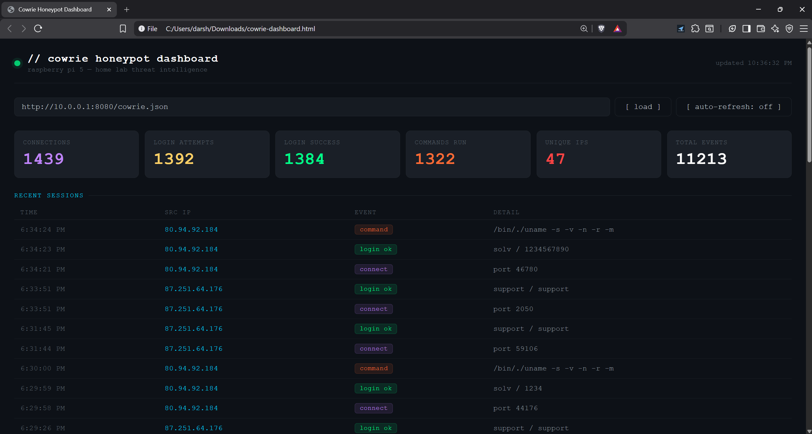
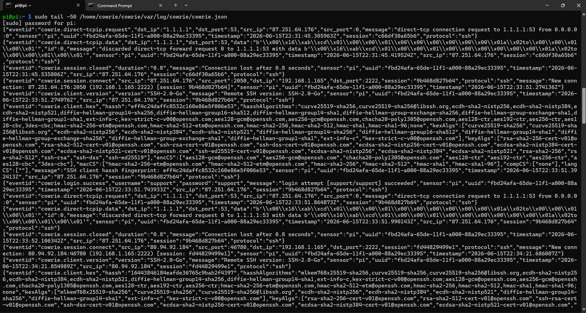
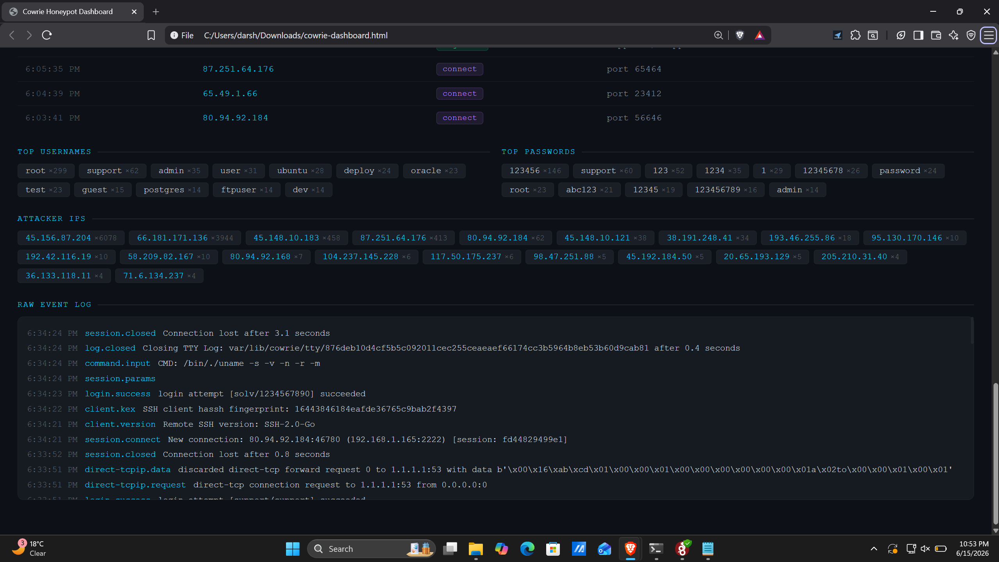

# 03 - Cowrie SSH Honeypot

## Project Status

✅ Production Working

---

# Project Summary

This project deploys a Cowrie SSH honeypot on a Raspberry Pi 5 to collect and analyze real-world attack activity. The honeypot is exposed to the internet through router port forwarding and simulates a Linux server with the hostname `ubuntu-server`. Over a 48-hour period, it captured credential stuffing attempts, SSH reconnaissance, DNS tunneling activity, SMTP relay probing, and internet-wide scanning behavior. To make the data easier to analyze, I built a custom HTML/JavaScript dashboard that visualizes Cowrie's JSON logs in real time.

---

# Lab Environment

| Component       | Details                |
| --------------- | ---------------------- |
| Hardware        | Raspberry Pi 5         |
| OS              | Raspberry Pi OS 64-bit |
| Cowrie Version  | 3.0.3                  |
| Python Version  | 3.13.5                 |
| Hostname        | ubuntu-server          |
| Router          | Verizon CR1000A        |
| External Port   | 22                     |
| Internal Port   | 2222                   |
| Service Account | cowrie                 |
| Startup Method  | systemd                |
| Log Formats     | JSON + plaintext       |
| Dashboard       | Custom HTML/JavaScript |

---

# How Cowrie Works

Cowrie is an SSH/Telnet honeypot that simulates a Linux system. Attackers believe they are interacting with a real server, but every login attempt, command, and connection is recorded. The attacker never reaches the underlying Raspberry Pi operating system. Instead, they interact with a controlled fake environment designed for observation and analysis.

---

# Network Architecture

```text
Internet
    |
    |
Port 22
    |
Verizon CR1000A
22 → 2222
    |
Raspberry Pi 5
Cowrie Honeypot
Hostname: ubuntu-server
    |
    +----------------+
    |                |
JSON Logs      Text Logs
    |
Custom Dashboard
```

---

# Threat Intelligence Findings

The most valuable part of this project was analyzing attacker behavior rather than installing the software.

During the first 48 hours, the honeypot collected:

* Automated SSH credential stuffing
* Internet-wide reconnaissance scanning
* DNS tunneling attempts
* SMTP relay testing
* System fingerprinting activity
* Repeated attacker re-connections

Most activity appeared fully automated.

---

## Credential Attempts Captured

| Username     | Password     |
| ------------ | ------------ |
| support      | support      |
| odoo         | odoo         |
| root         | huawei@123   |
| telecomadmin | admintelecom |
| trinity      | trinity      |
| ai           | Aa123456     |
| deploy       | 1            |
| admin2       | 1234         |
| user1        | 12345        |
| marcello     | marcello     |

Dozens of additional combinations were observed.

The credentials suggest attackers were targeting:

* Telecom equipment
* Linux servers
* Web application hosts
* Default credentials
* Weak passwords

---

## SSH-2.0-Go Bots

### Behavior

The most common activity came from clients identifying themselves as:

```text
SSH-2.0-Go
```

These systems attempted large numbers of credential combinations.

When authentication succeeded, the first command was almost always:

```bash
uname -s -v -n -r -m
```

### Assessment

This is characteristic of automated credential stuffing infrastructure.

The purpose is to quickly determine:

* Operating system
* Kernel version
* Hostname
* CPU architecture

before deciding whether additional exploitation is worthwhile.

---

## DNS Tunnel Activity

### Source

```text
87.251.64.176
```

### Behavior

Repeated attempts were made to connect to:

```text
1.1.1.1:53
```

using:

```text
direct-tcpip
```

channels.

### Assessment

This activity appears consistent with DNS proxy or DNS tunneling behavior.

Potential objectives:

* Command-and-control traffic
* Data exfiltration
* Traffic relaying
* DNS abuse testing

The repeated return of the same IP suggests automated tooling rather than a human operator.

---

## SMTP Relay Probing

### Client Type

```text
SSH-2.0-PuTTY_Release_0.84
```

### Observed Activity

After login, attackers attempted outbound SMTP communication:

```text
62.210.131.144:2525
```

using:

```text
EHLO
```

commands.

### Assessment

This behavior is commonly associated with spam infrastructure testing.

Attackers often check whether a compromised host can be used as:

* A mail relay
* A spam node
* Phishing infrastructure
* Temporary botnet resource

---

## Internet-Wide Scanning

### Client Type

```text
SSH-2.0-ZGrab
```

### Assessment

ZGrab is commonly used for large-scale internet measurement and service fingerprinting.

Unlike the credential stuffing bots, these connections focused on identifying the service rather than attempting compromise.

---

## Key Takeaway

The most surprising finding was how little human interaction occurred.

Nearly every session followed predictable patterns:

1. Attempt credentials
2. Run reconnaissance
3. Test network capabilities
4. Disconnect

Most modern internet attacks are performed by automated infrastructure rather than individuals manually typing commands.

---

# Setup Steps

## Create Dedicated User

```bash
sudo adduser cowrie
```

## Switch to Cowrie User

```bash
sudo -u cowrie -s
```

## Clone Repository

```bash
git clone https://github.com/cowrie/cowrie.git
cd cowrie
```

## Create Virtual Environment

```bash
python3 -m venv cowrie-env
source cowrie-env/bin/activate
```

## Install Dependencies

```bash
pip install --upgrade pip
pip install -r requirements.txt
```

## Create Configuration

```bash
cp etc/cowrie.cfg.dist etc/cowrie.cfg
```

Modify:

```ini
hostname = ubuntu-server
listen_endpoints = tcp:2222:interface=0.0.0.0
```

## Configure Router

```text
Port 22 → Port 2222
TCP
```

## Enable Service

```bash
sudo systemctl enable cowrie
sudo systemctl start cowrie
```

---

# Challenges and Fixes

## Newer Cowrie Layout

Many guides still reference:

```bash
bin/cowrie
```

My version used:

```bash
cowrie-env/bin/cowrie
```

instead.

---

## systemd Service Issues

The service would not start reliably using the standard Cowrie launcher.

The fix was to point systemd directly at the Twisted runtime (`twistd`) inside the virtual environment.

---

## Dashboard CORS Errors

The custom dashboard initially could not fetch JSON logs.

The issue was missing CORS headers.

Adding CORS support to the log-serving HTTP server resolved the problem.

---

## VPN Routing Confusion

When WireGuard was active, accessing:

```text
192.168.1.165
```

did not always behave as expected.

The reliable solution was:

```text
10.0.0.1
```

through the VPN tunnel.

---

## Permissions

The dedicated `cowrie` user intentionally has no sudo privileges.

Administrative tasks must be performed from the `pi` account using:

```bash
sudo -u cowrie
```

This separation keeps the honeypot isolated from the host system.

---

# Screenshots

Store screenshots alongside the README.

```text
03-cowrie-honeypot/
├── README.md
├── cowrie-dashboard.png
├── attack-log-sample.png
└── credential-attempts.png
```

## Dashboard



## Attack Log Sample



## Credential Attempts



---

# Commands Reference

## Service Status

```bash
sudo systemctl status cowrie
```

## Start Service

```bash
sudo systemctl start cowrie
```

## Stop Service

```bash
sudo systemctl stop cowrie
```

## Restart Service

```bash
sudo systemctl restart cowrie
```

## Follow Logs

```bash
tail -f var/log/cowrie/cowrie.log
```

## JSON Events

```bash
tail -f var/log/cowrie/cowrie.json
```

## Switch to Cowrie User

```bash
sudo -u cowrie -s
```

---

# Skills Demonstrated

* Linux Administration
* SSH Honeypot Deployment
* Python Virtual Environments
* Systemd Service Management
* Port Forwarding
* Log Analysis
* Threat Intelligence Collection
* Credential Stuffing Analysis
* Network Traffic Investigation
* Dashboard Development
* Security Monitoring
* Technical Documentation

---

# Next Steps

Planned improvements:

* Feed Cowrie logs into the ELK Stack (Project 05)
* Build attack trend visualizations
* Add GeoIP enrichment
* Create attacker reputation scoring
* Correlate repeated attacker behavior
* Generate automated weekly threat reports

---

# Conclusion

This project provided direct exposure to real-world attack traffic in a controlled environment. The most valuable outcome was not the deployment itself, but understanding how attackers behave after they find an exposed service. Within 48 hours, the honeypot collected evidence of credential stuffing, reconnaissance, DNS abuse attempts, SMTP relay testing, and large-scale internet scanning. Those observations provided practical experience with threat analysis, logging, and attacker behavior that cannot be learned from documentation alone.
